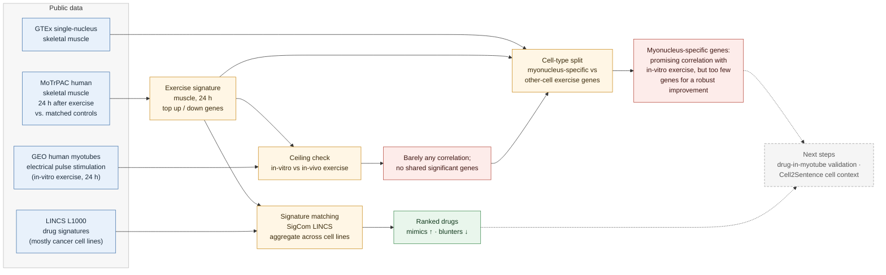

# exercise-mimetics

**Which drugs mimic, and which blunt, human exercise, and does the answer survive in muscle cells?**

Exercise is one of our most effective "drugs," but we don't know which real drugs reproduce its molecular effects or work against them. We matched the new human [MoTrPAC](https://motrpac-data.org) skeletal muscle response 24 h after exercise to [LINCS L1000](https://maayanlab.cloud/sigcom-lincs/) drug signatures. We then asked whether cultured human muscle cells are a fair stand-in for exercised muscle, and used single-nucleus data to separate the muscle-cell part of the exercise response from the part coming from other cell types.

Built in one day at the BioDATA ASCENT code-a-thon (Cold Spring Harbor Laboratory, November 2026).

## Visual abstract



A static version for slides is in [`docs/visual_abstract.png`](docs/visual_abstract.png).

## Why this matters

- **The human data is new.** Earlier MoTrPAC × LINCS work used the rat endurance-training atlas. The human pre-COVID cohort (175 sedentary adults, randomized to endurance, resistance or control) makes it possible to ask the question in people.
- **Blunting matters clinically.** Common drugs such as metformin and statins have been reported to dampen training adaptations. A systematic screen for drugs that oppose the exercise response could flag others.
- **Cell context is the weak link.** LINCS signatures come mostly from cancer cell lines, and drug validation is usually done in cultured cells. Whether either reflects exercised muscle in a person is an open question, and the one we ended up testing most directly.

## What we did

### 1. Exercise signature (skeletal muscle, 24 h)
From MoTrPAC's open differential-expression results (v1.3), we used the skeletal muscle *difference-in-changes* contrast at 24 h: change from pre-exercise in the exercise group, minus the matched change in controls. Genes were ranked by `t`, and the top up and down genes formed the query. We limited scope to one tissue and one timepoint to finish within the day.

### 2. Drug matching
The signature was queried against L1000 chemical perturbations with SigCom LINCS (two-sided rank enrichment). One LINCS signature is one drug × cell line × dose × time, so hits were aggregated per drug:
- strongest signature per drug within each cell line;
- median score across cell lines, number of cell lines hit, and fraction agreeing in direction;
- a hit requires ≥ 2 cell lines with consistent direction.

Positive controls: cAMP/PPARδ/AMPK agonists (forskolin, GW501516) should rank as mimics. Reported blunters (metformin, statins) should lean the other way.

### 3. Ceiling check: do cultured muscle cells model exercise?
Before using drug-treated myotubes as ground truth, we compared an in-vitro exercise model, electrical pulse stimulation of human primary myotubes for 24 h (GEO GSE44051), with the in-vivo muscle signature.

### 4. Cell-type split
A muscle biopsy is a mix of cell types, and much of the in-vivo exercise response may come from non-muscle cells (endothelial cells, fibro-adipogenic progenitors, immune cells) or whole-body signals that a dish lacks. Using GTEx single-nucleus skeletal muscle, we classified each exercise gene as myonucleus-specific or expressed mainly by other cell types, with thresholds fixed in advance. We then repeated the ceiling check on each class against a random-gene null.

## Results

- **In-vitro vs. in-vivo exercise:** electrical stimulation of myotubes barely correlates with the 24 h muscle response, and no significant genes change in the same direction in both.
- **Cell-type split:** restricted to myonucleus-specific genes, the correlation with in-vitro exercise looks promising, but too few genes qualify to establish a robust improvement over the other-cell genes or the random null.
- **Interpretation:** consistent with cultured muscle cells capturing, at most, the muscle-cell-intrinsic part of the exercise response, with much of the in-vivo signal coming from other cell types and systemic signals. Drug screens built on single-cell-type models are likely to miss these effects.
- **Drug matching:** *add the top mimics and blunters and where the control drugs rank.*

## Next steps

- Repeat across timepoints and in adipose and blood, and compare endurance with resistance exercise.
- Increase power for the cell-type split: more timepoints and contrasts, or a larger single-nucleus reference.
- Validate LINCS calls with drug-treated human myotubes (metformin GSE229658, GW501516 GSE40789, statins GSE107998), restricted to myonucleus-specific genes.
- Use single-cell foundation models (Cell2Sentence, Geneformer) to predict drug effects in each muscle cell type.

## Repository contents

```
exercise-mimetics/
├── README.md
├── exercise-mimetics.yml       # core conda environment (laptop, no GPU)
├── exercise-mimetics-gpu.yml   # GPU environment for Cell2Sentence / Geneformer
├── test_lincs.py               # SigCom LINCS query + per-drug aggregation
└── docs/                       # visual abstract
```

## Quick start

```bash
mamba env create -f exercise-mimetics.yml
conda activate exmim

# test the LINCS pipeline with a built-in dummy muscle signature
python test_lincs.py

# query with a real signature (one gene symbol per line)
python test_lincs.py --up muscle_24h_up.txt --down muscle_24h_down.txt \
                     --name muscle_24h --outdir results/lincs

# tissue-matched check (only the cell lines listed)
python test_lincs.py --up ... --down ... --cell-lines SKL ASC
```

## Data

| Source | What we used | Access |
|---|---|---|
| [MoTrPAC human pre-COVID sedentary adults](https://motrpac-data.org) | skeletal muscle transcriptomics differential-expression results, 24 h, v1.3 | open (CC BY 4.0), free Data Hub login; also via the [`MotrpacHumanPreSuspensionAnalysis`](https://motrpac.github.io/MotrpacHumanPreSuspensionAnalysis) R package |
| [SigCom LINCS](https://maayanlab.cloud/sigcom-lincs/) | L1000 chemical perturbation signatures | open API |
| [GEO](https://www.ncbi.nlm.nih.gov/geo/) | GSE44051: electrical pulse stimulation of human primary myotubes | open |
| [GTEx](https://gtexportal.org) | single-nucleus RNA-seq, skeletal muscle | open |

## Limitations

- One tissue (skeletal muscle) and one timepoint (24 h).
- LINCS signatures are mostly from cancer cell lines, at doses and times that don't match exercise physiology.
- Reversing the *acute* exercise response is not proof that a drug blunts *training adaptation*. Blunter calls are hypotheses.
- MoTrPAC Level 3 data are group-level results, so per-person analyses are out of scope.
- The ceiling check rests on one small array study, and single-nucleus data measure nuclear transcripts, which can miss some genes.
- Everything was built in one day. Treat results as a starting point.

## Related work

- Knowles (PI), NIH R03OD038388 (2024–2026): *Synergizing Common Fund Data from MoTrPAC and LINCS for the Discovery of Novel Exercise Mimetic Drugs* (rat training data).
- Brochet et al., *Circulation* 2025 (AHA abstract 4370739): *Integrative analysis of MoTrPAC and LINCS transcriptomes identifies cardiovascular-relevant exercise-mimetic drugs*.
- Mani (PI), NIH R03OD032626 (2021–2022): exercise mimetics from LINCS P100 phosphoproteomic signatures.
- Evangelista et al., *SigCom LINCS*, Nucleic Acids Research 2022.
- Rizvi et al., *Scaling Large Language Models for Next-Generation Single-Cell Analysis* (C2S-Scale), bioRxiv 2025.
- MoTrPAC Study Group et al. (2024). Molecular Transducers of Physical Activity Consortium (MoTrPAC): human studies design and protocol. *Journal of applied physiology (Bethesda, Md. : 1985)*, 137(3), 473–493. https://doi.org/10.1152/japplphysiol.00102.2024

## Team

*Names and roles to be added.*

| Workstream | Who |
|---|---|
| Exercise signature | |
| LINCS scoring | |
| In-vitro vs in-vivo check | |
| Interpretation, figures, write-up | |
| Cell-type split + coordination | Paul Schwerd-Kleine |

## Acknowledgements

Thanks to the organizers and mentors of BioDATA ASCENT, the NIH Common Fund Data Ecosystem (CFDE), NHGRI AnVIL, and Cold Spring Harbor Laboratory, and to the MoTrPAC and LINCS consortia for making their data public.

## License

Code: MIT. Data remain under their original licenses (MoTrPAC open data: CC BY 4.0).
