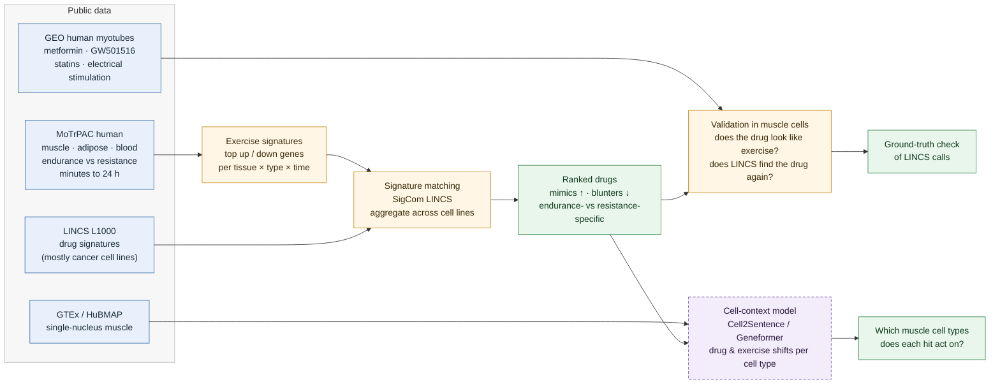

# exercise-mimetics

**Which drugs mimic, and which blunt, human exercise, and does the answer survive in muscle cells?**

Exercise is one of our most effective "drugs," but we don't know which real drugs reproduce its molecular effects or work against them. We match new human [MoTrPAC](https://motrpac-data.org) exercise signatures (muscle, adipose, blood; endurance vs. resistance) to [LINCS L1000](https://maayanlab.cloud/sigcom-lincs/) drug signatures, check the calls against drug-treated human muscle cells, and use single-cell foundation models to ask which muscle cell types each hit acts on.

Built in one day at the BioDATA ASCENT code-a-thon (Cold Spring Harbor Laboratory, November 2026).

## Visual abstract



A static version for slides is in [`docs/visual_abstract.png`](docs/visual_abstract.png).

## Why this matters

- **The human data is new.** Earlier MoTrPAC × LINCS work used the rat endurance-training atlas. The human pre-COVID cohort (175 sedentary adults, randomized to endurance, resistance or control) makes it possible to ask the question in people, and to separate exercise types.
- **Blunting matters clinically.** Common drugs such as metformin and statins have been reported to dampen training adaptations. A systematic screen for drugs that oppose the exercise response could flag others.
- **Cell context is the weak link.** LINCS signatures come mostly from cancer cell lines. We test how well they transfer to muscle, using real drug-treated human myotube data and single-cell models.

## Approach

### 1. Exercise signatures
From MoTrPAC's open differential-expression results (v1.3), we take the *difference-in-changes* contrasts: change from pre-exercise in each exercise group, minus the matched change in controls. For each tissue × exercise type × timepoint, genes are ranked by `t`, and the top ~100–150 up and down genes form the query.

### 2. Drug matching
Each signature is queried against L1000 chemical perturbations with SigCom LINCS (two-sided rank enrichment). One LINCS signature is one drug × cell line × dose × time, so hits are aggregated per drug:
- strongest signature per drug within each cell line;
- median score across cell lines, number of cell lines hit, and fraction agreeing in direction;
- a hit requires ≥ 2 cell lines with consistent direction.

Rankings are cross-checked against Enrichr's `LINCS_L1000_Chem_Pert_Consensus_Sigs` library, which has one consensus signature per drug. Positive controls: cAMP/PPARδ/AMPK agonists (forskolin, GW501516) should rank as mimics. Reported blunters (metformin, statins) should lean the other way.

### 3. Validation in human muscle cells
Public human primary myotube datasets give drug-in-muscle signatures:

| GEO | Treatment | Platform |
|---|---|---|
| GSE40789 | GW501516 (PPARδ agonist) | array |
| GSE44051 | electrical pulse stimulation (in-vitro exercise) | array |
| GSE229658 | metformin, 16–776 µM, 48 h | RNA-seq |
| GSE107998 | lipophilic vs hydrophilic statin, 25 donors | RNA-seq |
| GSE70822, GSE77212 | aldosterone/spironolactone, DGAT1 inhibitor (background) | array |

For each, we ask (a) does the drug-in-muscle signature resemble the exercise signature (Spearman, prerank GSEA), and (b) when LINCS is queried with the myotube signature, does the same drug come back near the top?

### 4. Stretch goal: cell-type context
Using GTEx single-nucleus skeletal muscle as the cell context, we apply exercise and drug expression shifts to real muscle cells (type I/II myonuclei, fibro-adipogenic progenitors, endothelial cells, macrophages), embed them with Cell2Sentence (`vandijklab/C2S-Scale-Gemma-2-2B`) or Geneformer, and compare drug and exercise shifts per cell type. A plain expression-weighted correlation is the baseline the model has to beat.

## Results

*To be filled in by 5 pm.*

- [ ] Ranked mimics and blunters per tissue × exercise type × timepoint
- [ ] Where the control drugs rank
- [ ] Endurance-specific vs resistance-specific hits
- [ ] Myotube validation heatmap
- [ ] LINCS self-retrieval of myotube drug signatures
- [ ] Cell-type map of top hits

## Repository layout

```
exercise-mimetics/
├── envs/                     # conda environments (core + GPU)
├── data/                     # not tracked; see "Data" below for download steps
├── scripts/
│   └── sigcom_query.py       # SigCom LINCS query + per-drug aggregation
├── notebooks/
│   ├── 01_exercise_signatures.ipynb
│   ├── 02_lincs_scoring.ipynb
│   ├── 03_myotube_validation.ipynb
│   └── 04_cell_context_c2s.ipynb
├── signatures/               # shared format: gene, score, direction
│   ├── exercise/
│   └── myotube/
├── results/                  # tables and figures
└── docs/                     # visual abstract, slides, blog draft
```

## Quick start

```bash
# core analysis environment (laptop, no GPU)
mamba env create -f envs/exercise-mimetics.yml
conda activate exmim

# test the LINCS pipeline with a built-in dummy muscle signature
python scripts/sigcom_query.py

# query with a real signature
python scripts/sigcom_query.py --up signatures/exercise/muscle_EE_4h_up.txt \
                               --down signatures/exercise/muscle_EE_4h_down.txt \
                               --name muscle_EE_4h --outdir results/lincs

# tissue-matched check (only cell lines listed)
python scripts/sigcom_query.py --up ... --down ... --cell-lines SKL ASC
```

For the Cell2Sentence part, use `envs/exercise-mimetics-gpu.yml` (Linux GPU, or Apple Silicon for embeddings only).

## Data

| Source | What we use | Access |
|---|---|---|
| [MoTrPAC human pre-COVID sedentary adults](https://motrpac-data.org) | differential-expression tables (transcriptomics: muscle, adipose, blood), v1.3 | open (CC BY 4.0), free Data Hub login; also via the [`MotrpacHumanPreSuspensionAnalysis`](https://motrpac.github.io/MotrpacHumanPreSuspensionAnalysis) R package |
| [SigCom LINCS](https://maayanlab.cloud/sigcom-lincs/) | L1000 chemical perturbation signatures | open API |
| [Enrichr](https://maayanlab.cloud/Enrichr/) | `LINCS_L1000_Chem_Pert_Consensus_Sigs` | open |
| [GEO](https://www.ncbi.nlm.nih.gov/geo/) | myotube datasets listed above | open |
| [GTEx](https://gtexportal.org) | single-nucleus RNA-seq, skeletal muscle | open |
| [Hugging Face](https://huggingface.co/vandijklab) | C2S-Scale-Gemma-2-2B weights | open (CC BY 4.0) |

## Limitations

- LINCS signatures are mostly from cancer cell lines, at doses and times that don't match exercise physiology.
- Reversing the *acute* exercise response is not proof that a drug blunts *training adaptation*. Blunter calls are hypotheses.
- MoTrPAC Level 3 data are group-level results, so per-person analyses (e.g. responders vs non-responders) are out of scope.
- Myotube validation uses few drugs, mixed platforms and often high doses, so it is a qualitative check, not a benchmark.
- Everything was built in one day. Treat results as a starting point.

## Related work

- Knowles (PI), NIH R03OD038388 (2024–2026): *Synergizing Common Fund Data from MoTrPAC and LINCS for the Discovery of Novel Exercise Mimetic Drugs* (rat training data).
- Brochet et al., *Circulation* 2025 (AHA abstract 4370739): *Integrative analysis of MoTrPAC and LINCS transcriptomes identifies cardiovascular-relevant exercise-mimetic drugs*.
- Mani (PI), NIH R03OD032626 (2021–2022): exercise mimetics from LINCS P100 phosphoproteomic signatures.
- Evangelista et al., *SigCom LINCS*, Nucleic Acids Research 2022.
- Rizvi et al., *Scaling Large Language Models for Next-Generation Single-Cell Analysis* (C2S-Scale), bioRxiv 2025.

## Team

*Names and roles to be added.*

| Workstream | Who |
|---|---|
| Exercise signatures | |
| LINCS scoring | |
| Myotube validation | |
| Interpretation, figures, write-up | |
| Cell2Sentence + coordination | Paul Schwerd-Kleine |

## Acknowledgements

Thanks to the organizers and mentors of BioDATA ASCENT, the NIH Common Fund Data Ecosystem (CFDE), NHGRI AnVIL, and Cold Spring Harbor Laboratory, and to the MoTrPAC and LINCS consortia for making their data public.

## License

Code: MIT. Data remain under their original licenses (MoTrPAC open data: CC BY 4.0).
